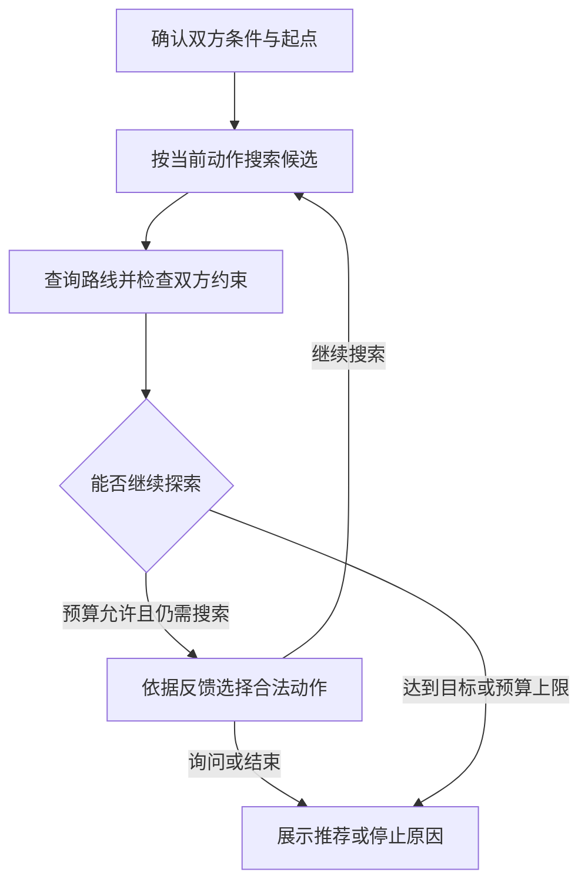

# MeetPoint Agent：双人公共交通会合规划

两个人从不同地点出发，通勤时间、换乘次数和步行上限也不同。MeetPoint 查询双方到候选商场的公共交通路线，根据中间结果调整搜索动作，在预算内给出满足双方约束、可查看引用依据的推荐。

**Python · FastAPI · LangGraph · SQLite · Qwen · Docker Compose**

当前演示范围：**北京市、两人、公共交通、商场**。文本模型为 `qwen3.7-flash`，通过 DashScope 的 OpenAI 兼容接口调用；真实地图使用高德 Web 服务。

正式评测已执行 1680/1680 个试次，V2 主评测自动验收为 462/480（96.25%）。一次连接异常请求缺少 usage，严格测量完整性门禁保留为 `false`；自然语言修改开发验收为 31/36（86.1%）。详细分母、规则基线和限制见下文。

## 功能

- **核对双方路线约束**：分别检查通勤耗时、换乘与步行，筛掉不满足条件的路线，对可行候选进行 Pareto 筛选与排序。
- **根据反馈继续搜索**：维护已查候选、双方失败摘要、已尝试动作及剩余预算，支持向 A/B 侧移动、扩大半径、询问用户或结束。
- **约束由代码执行**：模型提出动作，执行器校验合法动作、参数、条件版本及预算；部分明确场景通过受控规则处理。
- **保存条件与明确偏好**：区分本次要求和长期默认值；自然语言修改先生成差异预览，用户确认后写入。
- **展示结构化依据**：推荐卡片提供地点及双方路线的 8 项引用依据、通勤余量，并提示营业状态尚未核验。
- **记录执行证据**：保存控制状态、调用计数、停止原因与评测分子分母；不把缺失 usage 当成零用量。

## Agent 如何运行



首轮使用共享搜索起点，后续结合累计反馈选择动作。模型负责受限动作选择；约束判断、预算扣减、候选去重、排序与结果发布由代码负责。M10 还包含确定性快路径，因此并非每个任务、每一轮都调用模型。

若 A 侧路线已经被确认不满足硬约束，可以跳过该候选 B 侧的路线查询，并保留短路依据。未知字段不作为“已证明不可行”的证据。

当搜索轮数用满时，如果已有可行候选，可以返回这些结果。因此 `outcome=feasible_found` 与 `stop_reason=budget_exhausted:search_rounds` 可以同时出现；这不表示找到了全城最优方案。

## 工程实现

| 部分 | 实现 |
| --- | --- |
| API 契约 | FastAPI + Pydantic 严格校验，拒绝未知字段、非法数值和不符合契约的更新 |
| 会话一致性 | `constraints_version` 与偏好 revision 校验，过期运行和旧预览不能覆盖新条件 |
| 状态存储 | SQLite 事务保存会话条件、运行计数、停止状态、长期偏好和修改事件 |
| 预算 | HTTP、模型请求、搜索轮数及候选数上限；每次实际尝试分别计数，重试也消耗预算 |
| 检查点 | LangGraph + SQLite，持久化控制字段；恢复已确认条件后重新查询路线 |
| 自然语言修改 | 模型提案 → 白名单与证据校验 → 差异预览 → 用户确认 → 事务写入；支持取消与过期检查 |
| 推荐证据 | 关联本次运行、条件版本和结构化工具证据，验证通过后展示卡片 |
| 网页运行 | 单进程、单个活动规划任务；候选和路线用于临时内存处理与展示 |

默认预算为地图 HTTP 40 次、模型调用 12 次、搜索 3 轮、每轮最多 5 个候选。提前结束的可行候选目标为 3 个；最终卡片经过 Pareto 筛选，数量可能少于 3 个。

SQLite 保存用户确认的条件和控制状态；真实地图的候选、坐标及完整路线不作为长期原始响应库存储。网页临时结果约保留 10 分钟。恢复会话不等于恢复旧路线缓存，也不保证从任意中断节点原地续跑。

## 本地运行

需要 Git、Docker Desktop 和 Docker Compose。以下命令适用于 Windows PowerShell；已有项目直接进入原目录即可。

```powershell
git clone https://github.com/Nancy1022-cloud/meetpoint-agent.git
Set-Location .\meetpoint-agent

if (-not (Test-Path .\.env)) {
    Copy-Item .\.env.example .\.env
}
```

在自己的 `.env` 中填写配置：

```dotenv
AMAP_WEB_KEY=your_amap_web_service_key
LLM_API_KEY=your_dashscope_api_key
LLM_BASE_URL=https://dashscope.aliyuncs.com/compatible-mode/v1
LLM_MODEL=qwen3.7-flash
AMAP_MIN_INTERVAL_SECONDS=1.1
```

启动：

```powershell
docker compose up -d --build app
Invoke-RestMethod http://127.0.0.1:8001/health
```

- 演示页面：[http://127.0.0.1:8001/demo](http://127.0.0.1:8001/demo)
- OpenAPI 文档：[http://127.0.0.1:8001/docs](http://127.0.0.1:8001/docs)
- 网页接口检查：[http://127.0.0.1:8001/api/m6/health](http://127.0.0.1:8001/api/m6/health)

`/health` 只检查服务和配置存在，不会证明高德权限、余额或模型调用已经可用。接口中的 M1/M6 名称沿用工程阶段命名，不表示没有接入后续模块。

### 演示一个场景

1. 在页面使用独立的演示用户，创建新会话。
2. A 填“五道口地铁站”、最多 60 分钟；B 填“国贸地铁站”、最多 45 分钟。双方最多换乘 1 次、步行 1500 米。
3. 选择总耗时优先，确认条件；选择有效出发日期与时间，点击开始规划。
4. 核对并点选 A/B 的起点匹配，等待搜索结束。
5. 查看双方路线、停止原因和引用依据，在“本次运行与指标”中复制验收摘要。

真实规划会消耗地图请求和可能的模型 Token，权限与额度取决于自己的账号。接口错误、预算用尽或未找到方案都应保留真实状态。名称中包含装修或停业信息时，页面提示待核验；本项目未查询真实营业状态。

修改 `.env` 后，可用 `docker compose up -d --force-recreate app` 重新加载环境。

## 自动化测试

覆盖工具契约、约束、预算、条件版本、检查点、偏好隔离、提案确认与评测完整性等行为。

```powershell
$mpProjectPath = (Get-Location).Path
docker compose run --rm --no-deps --env PYTHONUTF8=1 --env PYTHONIOENCODING=utf-8 --volume "${mpProjectPath}:/verify-work" --workdir /verify-work app python -m unittest app.test_m2 app.test_m3 app.test_m4 app.test_m5 app.test_m6 app.test_m7 app.test_m8 app.test_m9 app.test_m10 app.test_m11 app.test_m12 -q
```

该命令把整个工程挂入验证目录，使测试能够读取根目录的接入脚本和补丁清单；只挂载 `app/` 时可能缺少这些测试依赖。

2026-10-30 原验收日志为 **366 项，OK**，其中包含 M12 新增的 28 项，不能相加。GitHub 同步前，又在禁用外部网络的核对环境中执行这 366 项回归，全部通过；部分依赖版本与原正式环境不同，详见 [发布前离线核对](docs/evaluation/m12/PUBLICATION_CHECK.md)。

## 冻结评测

模型：`qwen3.7-flash`。固定预算、参数、执行顺序、用例和判分源码；失败、缺测与未知费用预留均保留。

| 项目 | 规模 |
| --- | ---: |
| 开发集 | 50 条 |
| 正式作者自建用例 | 200 条、40 个相关场景族 |
| 正式分组 | 规划 80、范围拒答 40、异常 40、受控 Memory 40 |
| 两主臂 | V1/V2 各 600 试次，共 1200 |
| 规划基线 | B0/RULE 各 240 试次，共 480 |
| 总执行量 | 1680/1680 试次 |

每条在适用策略下重复 3 次。作者已看过数据，场景族存在相关变体，不能称独立盲测，也不能把 1680 试次写成 1680 条独立任务。

V1 为原 M9 搜索与范围规则，V2 为 M10 优化策略。两臂受控 Memory 均沿用原解析路径；该组不验证 M11 自然语言解析。

### 任务结果

`main` 不包含 Memory：每臂为 160 条任务 × 3 次＝480 试次。

| 分组 | V1 | V2 |
| --- | ---: | ---: |
| main 自动验收 | 453/480（94.38%） | 462/480（96.25%） |
| 规划自动验收 | 216/240（90.00%） | 225/240（93.75%） |
| 范围拒答组自动验收 | 117/120（97.50%） | 117/120（97.50%） |
| 异常组自动验收 | 120/120（100.00%） | 120/120（100.00%） |
| 受控 Memory 自动验收 | 120/120（100.00%） | 120/120（100.00%） |

| V2 main 指标 | 实测 |
| --- | ---: |
| 结构化引用准确率 | 3480/3480（100%） |
| 结构化引用覆盖率 | 3480/3480（100%） |
| 范围拒答 Precision | 117/117（100%） |
| 范围拒答 Recall | 117/120（97.5%） |
| 明确登记的正常规划任务误拒率 | 0/240 |
| 平均业务工具调用 | 5.4292 次/试次 |
| 平均总 Token | 659.0438/试次；V2 该组 usage 完整 |

引用只核验已定义的结构化推荐字段，不能扩展为任意自由文本真实性。范围拒答使用确定性规则；Memory 没有推荐事实引用时为 N/A。

### 规划基线与成本口径

| 规划策略 | 自动验收 | 平均业务工具调用 | 平均总 Token |
| --- | ---: | ---: | ---: |
| B0 固定策略 | 210/240（87.50%） | 9.0000 | 0 |
| RULE 反馈规则 | 240/240（100.00%） | 9.3125 | 0 |
| V1 | 216/240（90.00%） | 8.9333 | 1455.8083 |
| V2 | 225/240（93.75%） | 8.5583 | 1249.5250 |

规则基线在这批规划任务上的通过率高于 V2，本批未证明模型优于规则。规划组独立列出，避免大量零模型路径稀释 main 平均成本；失败任务仍计入成本。

全批真实模型请求尝试 703 次，702 次有有效 usage，覆盖率 99.8578%。已观测总 Token 下界为 **723560**；一次 `APIConnectionError` 请求用量仍未知，V1 main 平均总 Token 与全批实际总量不能填为完整测量值。成功重试不会补回原请求的 usage。

已定义硬检查和 V2 预设效果目标通过；`measurement_complete=false`、`acceptance_gate_passed=false`、`M12_delivery_complete=false`、配对报告的 `valid_for_effect_claims=false` 保持不变。保留配对诊断，不发布完整测量已经支持全面节省或因果改善的结论。

主评测采用自建有限地图工具环境，**真实高德 HTTP 为 0**；模型调用为真实接口调用。真实地图现场检查另列。

## 自然语言修改的独立验收

M11 开发集共 36 条对话，NL 路径通过 **31/36（86.1%）**，低于预设 90% 目标；保留 5 条误澄清。M12 的受控 Memory 120/120 不能替代该结论。

自然语言修改的工程边界为“模型只提案、代码校验、用户确认后写入”，不宣称任意表达都能被正确解析。

## 一次真实高德现场检查

2026-10-30 当前版本完成一次现场规划，出发时间为 2026-10-31 10:00：

| 项目 | 记录 |
| --- | --- |
| 地图请求 | 25/40，计数一致，重试 0 |
| 模型请求 | 1/12，返回 `qwen3.7-flash` |
| 模型用量 | 输入 1166＋输出 50＝1216 Token，usage 1/1 |
| 搜索轮数 | 3/3，按轮数上限结束 |
| 结果 | 评估 10 个候选，2 个可行，展示 1 个推荐 |
| 检查点边界 | 11 个检查点，字段边界检查通过 |
| 单次耗时 | 33.132 秒，包含起点点选等待 |

截图核对了装修待核验提示和双方通勤余量；8 项引用处于折叠状态，未逐项做现场核对。一次场景不构成在线策略对照、城市泛化结论或稳定延迟指标。该次调用不加入主评测分母，也不消除主评测中的 usage 缺口。

## 目录与证据

```text
app/
  main.py                 FastAPI 入口
  m1_models.py            条件、预算和请求契约
  m1_store.py             会话、运行和计数事务
  m2_client.py            高德客户端与限流
  m3_core.py              路线约束、Pareto 筛选与排序
  m6_runtime.py           网页任务执行
  m9_evidence.py          推荐证据与展示核验
  m10_planner.py          搜索反馈、短路和快路径
  m11_store.py            修改提案的确认与写入
  m12.py                  冻结、执行和完整性检查
  m12_report.py           指标与配对报告
  static/meetpoint.html   单页演示
docs/evaluation/m12/      本轮公开评测摘要
data/                    本地数据库和完整运行产物
```

评测入口：

- [完整验收记录](docs/evaluation/m12/M12_ACCEPTANCE.md)
- [五项指标与分母](docs/evaluation/m12/summary.json)
- [报告](docs/evaluation/m12/report.md) / [配对诊断](docs/evaluation/m12/comparison.md)
- [全部自动验收失败](docs/evaluation/m12/failures.jsonl)
- [冻结清单与源码哈希](docs/evaluation/m12/manifest.json) / [选中用例](docs/evaluation/m12/cases.json)
- [后补现场检查](docs/evaluation/m12/ONLINE_VALIDATION.md)

M7 的早期实验仍保留在 [M7 验收记录](M7_ACCEPTANCE.md) 和 [历史评测目录](evaluation/m7_v1/)，其模型、数据规模与本轮不同，单独阅读。

完整 `results.jsonl`、`events.jsonl`、费用账本和源码快照保留在本地验收包；公开摘要不替代这些原始记录。离线复算需使用对应原归档及冻结判分源码。修改策略后的新实验应另建版本，并注明原数据已经被观察。

当前为本地演示工程：演示 user_id 不构成生产身份认证；SQLite、单进程执行及临时结果保留机制未经过生产并发部署验收。
